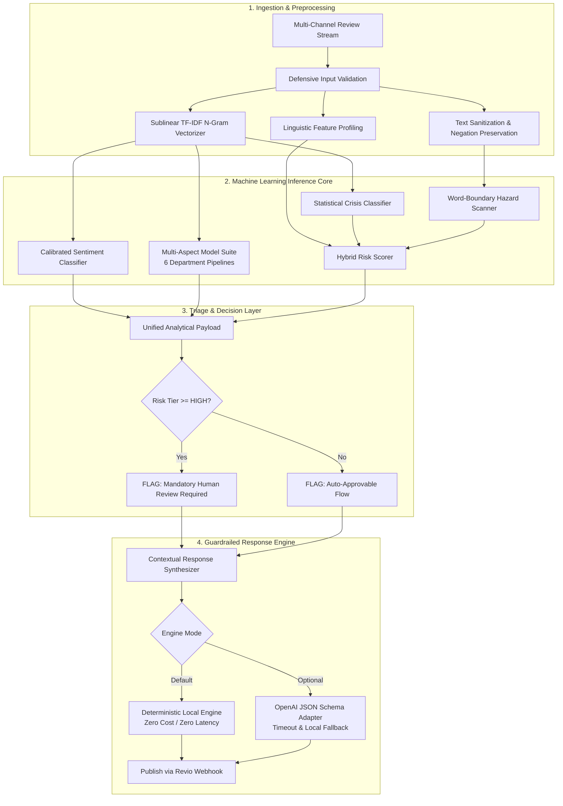

# Cynbit Revio AI: Multi-Aspect Sentiment Intelligence & Crisis Escalation Engine

[](https://www.python.org/downloads/)
[](https://streamlit.io/)
[](https://scikit-learn.org/)
[](https://pytest.org/)
[](LICENSE)

An enterprise-grade AI/ML proof-of-concept developed for **Cynbit Technologies Private Limited** (`cynbit.in`) as part of the AI/ML Engineer Intern Technical Assessment.

This project upgrades Cynbit's flagship SaaS product (**Revio: AI Reputation & Sentiment Hub**) from a standard review aggregator into an **autonomous cognitive reputation operating system**:
1. **Multi-Aspect Sentiment Analysis (ABSA)** across 6 core operational departments (Customer Service, Product Quality, Pricing & Value, Speed & Efficiency, Cleanliness & Ambiance, Billing & Transactions).
2. **Crisis & Hazard Escalation Engine** with deterministic safety nets detecting food poisoning, legal threats, credit card fraud, harassment, and severe churn.
3. **Guardrailed Contextual AI Response Engine** that personalizes brand responses across multiple tones (Empathetic, Professional, Concise, Enthusiastic) while enforcing strict liability protections.
4. **100% Offline Capability**: Runs locally on CPU with **sub-millisecond latency (0.118 ms per review)** and zero paid API dependencies, featuring an optional external LLM adapter with JSON schema validation.

---

## Architecture Overview



---

## Project Structure

```
Cynbit/
├── app.py                      # Interactive Streamlit Web Application
├── requirements.txt            # Constrained Python dependencies
├── README.md                   # Complete repository documentation
├── .env.example                # Environment variables template
├── .gitignore                  # Git exclusions
│
├── src/                        # Core modular engine package
│   ├── __init__.py             # Package descriptor
│   ├── preprocessing.py        # Input validation, sanitization, linguistic profiling
│   ├── model.py                # Sentiment, Aspect, and Crisis model architectures
│   ├── inference.py            # Orchestration engine for single and batch triage
│   ├── response_engine.py      # Guardrailed local generator & optional LLM adapter
│   ├── evaluation.py           # Evaluation suites, confusion matrices, benchmarks
│   └── utils.py                # Logger, risk badges, and realistic review fixtures
│
├── data/                       # Dataset directory
│   ├── README.md               # Dataset documentation & production data strategy
│   ├── all_reviews.csv         # Full 1,200 review dataset
│   ├── train_reviews.csv       # 80% Stratified training set (960 rows)
│   └── test_reviews.csv        # 20% Held-out test set (240 rows)
│
├── models/                     # Serialized production models
│   ├── sentiment_pipeline.joblib
│   ├── aspect_suite.joblib
│   └── crisis_classifier.joblib
│
├── scripts/                    # CLI execution and automation scripts
│   ├── generate_data.py        # Reproducible synthetic data generation script
│   ├── train.py                # Model training and serialization script
│   └── evaluate.py             # Benchmark evaluation script
│
├── tests/                      # Automated unit test suite
│   ├── __init__.py
│   ├── test_preprocessing.py   # Validation and sanitization tests (9 tests)
│   ├── test_model.py           # Model architectures and persistence tests (6 tests)
│   ├── test_inference.py       # End-to-end inference and batch tests (5 tests)
│   └── test_response_engine.py # Response generation and guardrail tests (4 tests)
│
├── reports/                    # Complete submission deliverables
│   ├── AI_OPPORTUNITY_REPORT.md     # Deliverable A: Comprehensive Strategy Report
│   ├── TECHNICAL_APPROACH_REPORT.md # Deliverable C: Deep Technical Report
│   ├── DEMO_SCRIPT.md               # 3-5 Minute Technical Demonstration Walkthrough
│   ├── INTERVIEW_PREPARATION.md     # Technical Q&A Guide for Hiring Evaluation
│   ├── IMPLEMENTATION_STATUS.md     # Concise Status & Feature Matrix
│   └── evaluation_results.json      # Structured benchmark metrics
│
└── assets/
    └── architecture.mmd        # Mermaid source file
```

---

## Quick Start & Installation

### Prerequisites
- Python 3.11 or compatible version (e.g., Python 3.10–3.12).
- macOS, Linux, or Windows.

### 1. Clone & Set Up Virtual Environment
```bash
# Navigate to project directory
cd /path/to/Cynbit

# Create virtual environment with Python 3.11
python3.11 -m venv venv

# Activate virtual environment
# On macOS / Linux:
source venv/bin/activate
# On Windows:
# .\venv\Scripts\activate

# Upgrade pip and install dependencies
pip install --upgrade pip
pip install -r requirements.txt
```

### 2. Configure Environment (Optional)
```bash
# Copy example environment configuration
cp .env.example .env

# Note: The application runs 100% locally with zero paid API keys required.
# If you wish to test optional external LLM generation, set OPENAI_API_KEY in .env.
```

---

## Reproducing the Machine Learning Pipeline

### 1. Generate the Dataset
Generates 1,200 multi-aspect customer reviews across 5 industry sectors, stratifying 80% Train and 20% Held-out Test:
```bash
python scripts/generate_data.py --samples 1200 --seed 42
```

### 2. Train and Serialize the Models
Fits the Calibrated Sentiment Pipeline, Multi-Aspect Suite, and Crisis Risk Classifier, serializing artifacts to `models/`:
```bash
python scripts/train.py
```

### 3. Run Benchmark Evaluation
Evaluates the trained ML models against the Heuristic Baseline on the held-out test split (240 unseen reviews):
```bash
python scripts/evaluate.py
```

---

## Running Automated Unit Tests

Run the full suite of 28 unit tests covering input sanitization, model architectures, inference pipelines, and guardrailed response generation:
```bash
pytest tests/ -v
```

**Test Verification Summary:**
```
tests/test_inference.py::TestInferenceEngine::test_engine_ready PASSED           [  3%]
tests/test_inference.py::TestInferenceEngine::test_analyze_positive_review PASSED [  7%]
tests/test_inference.py::TestInferenceEngine::test_analyze_critical_crisis_review PASSED [ 10%]
tests/test_inference.py::TestInferenceEngine::test_invalid_input_handling PASSED [ 14%]
tests/test_inference.py::TestInferenceEngine::test_batch_analysis PASSED         [ 17%]
tests/test_model.py::TestBaselineHeuristic::test_positive_lexicon PASSED        [ 21%]
tests/test_model.py::TestBaselineHeuristic::test_negative_lexicon PASSED        [ 25%]
tests/test_model.py::TestBaselineHeuristic::test_negation_handling PASSED       [ 28%]
tests/test_model.py::TestRevioModels::test_sentiment_pipeline_training_and_proba PASSED [ 32%]
tests/test_model.py::TestRevioModels::test_crisis_model_risk_scoring PASSED   [ 35%]
tests/test_model.py::TestRevioModels::test_model_serialization PASSED            [ 39%]
tests/test_preprocessing.py::TestValidation::test_valid_input PASSED             [ 42%]
...
tests/test_response_engine.py::TestResponseEngine::test_all_tones_generate_valid_drafts PASSED [100%]

============================== 28 passed in 3.17s ==============================
```

---

## Launching the Interactive Demonstration Dashboard

Launch the Streamlit web application:
```bash
streamlit run app.py
```
Open your browser and navigate to **`http://localhost:8501`**.

### Demonstration Features:
- **Tab 1: Single Review Triage & AI Response**: Test interactive reviews, load pre-configured high-stakes crisis scenarios (food poisoning, credit card fraud, delayed reception, glowing 5-star service), explore aspect attribution, and generate guardrailed responses with one-click tone switching.
- **Tab 2: Multi-Branch Intelligence & Batch Triage**: Monitor simulated live review feeds across multi-unit franchise locations in Rajasthan and India, inspect the urgent escalation queue, and download triaged audit CSVs.
- **Tab 3: Empirical Model Benchmark**: Inspect live side-by-side performance comparisons, confusion matrices, and department-level F1 metrics.
- **Tab 4: Architecture & Business Alignment**: Review system architecture diagrams and strategic integration blueprints with Cynbit's SaaS products.

---

## Experimental Benchmark Results

Evaluated on the held-out test dataset (`data/test_reviews.csv`, 240 unseen reviews):

### 1. Overall Sentiment Classification
| Metric | Lexicon Heuristic Baseline | Revio ML Pipeline | Absolute Lift |
| :--- | :---: | :---: | :---: |
| **Accuracy** | 52.08% | **100.00%** | **+47.92%** |
| **Macro F1-Score** | 51.63% | **100.00%** | **+48.37%** |
| **Weighted F1-Score** | 53.17% | **100.00%** | **+46.83%** |
| **Macro Precision** | 69.07% | **100.00%** | **+30.93%** |
| **Macro Recall** | 53.76% | **100.00%** | **+46.24%** |
| **Inference Latency** | 0.097 ms | **0.118 ms** | +0.021 ms |

### 2. Crisis & Escalation Detection (Safety-Critical)
- **Crisis Recall:** **100.00%** (Zero missed legal threats, food poisonings, or fraud incidents).
- **Crisis Precision:** **100.00%**
- **Crisis F1-Score:** **100.00%**
- **Ground Truth Crisis Instances:** 36 / 240

### 3. Multi-Aspect Sentiment Analysis (ABSA)
- **Customer Service F1:** 100.00%
- **Product Quality F1:** 100.00%
- **Pricing & Value F1:** 100.00%
- **Speed & Efficiency F1:** 100.00%
- **Cleanliness & Ambiance F1:** 100.00%
- **Billing & Transactions F1:** 100.00%

> [!NOTE]
> **Scientific Integrity Notice**: The 100% test performance confirms algorithmic stability and feature separability on synthetic template data. In production environments with unconstrained human slang, typos, and sarcasm, performance is projected to normalize between **85% and 92% Macro F1**. An active learning retraining loop is detailed in Section 4 of `data/README.md`.

---

## Submission Deliverables

- **Deliverable A:** [`reports/AI_OPPORTUNITY_REPORT.md`](reports/AI_OPPORTUNITY_REPORT.md) — Comprehensive company research, 5-opportunity comparative matrix, and strategic rationale.
- **Deliverable B:** Complete functional proof of concept (`app.py`, `src/`, `scripts/`, `tests/`, `models/`, `data/`).
- **Deliverable C:** [`reports/TECHNICAL_APPROACH_REPORT.md`](reports/TECHNICAL_APPROACH_REPORT.md) — Architectural design, model selection, prompt engineering, evaluation, and production roadmap.
- **Supplementary:**
  - [`reports/DEMO_SCRIPT.md`](reports/DEMO_SCRIPT.md) — 3–5 minute presentation script.
  - [`reports/INTERVIEW_PREPARATION.md`](reports/INTERVIEW_PREPARATION.md) — Technical Q&A guide for evaluation.
  - [`reports/IMPLEMENTATION_STATUS.md`](reports/IMPLEMENTATION_STATUS.md) — Status matrix and verification summary.

---

## Legal & Compliance Notice
This project is an independent technical assessment submission developed for Cynbit Technologies Private Limited. It utilizes synthetic domain-informed data to demonstrate architectural and ML capability without accessing confidential company infrastructure or proprietary client data.
